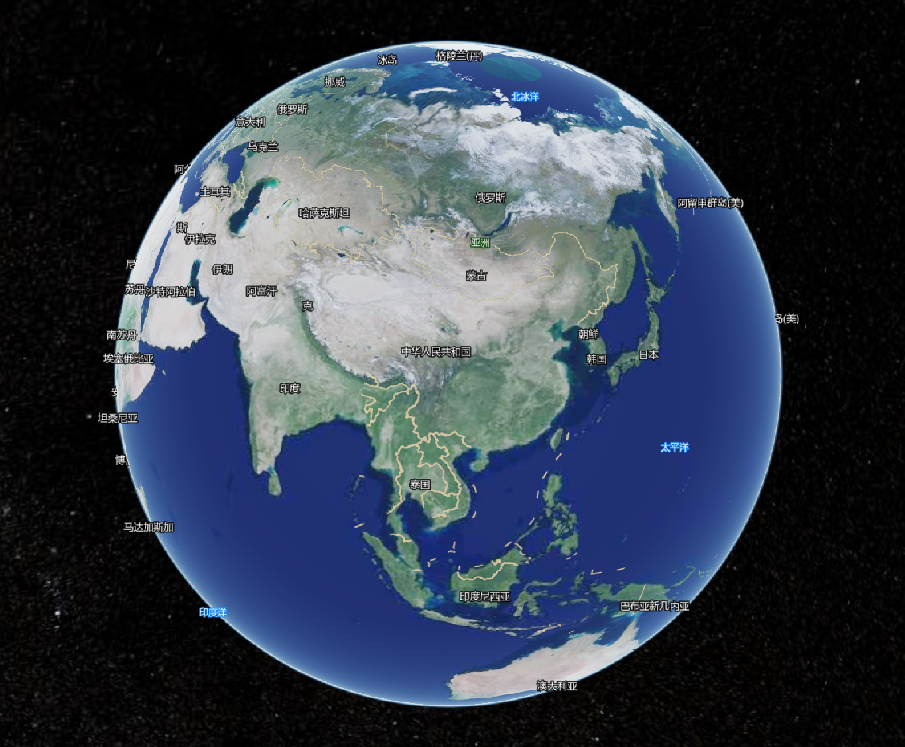

# 天地图三维服务接入代码示例

使用 CesiumJS 加载天地图影像、国界、三维地形和地名服务。

## 版本支持

- 当前适配：**CesiumJS 1.147**。
- 其他版本：暂未验证。

切换版本时，需同步修改 `index.html` 中的 Cesium 脚本和 CSS 地址。

## 运行

1. 在 `static/main.js` 中填写自己的天地图 `token`，并配置 Key 的域名白名单。
2. 通过静态 Web 服务访问 `index.html`，请勿直接双击文件打开。

## 示例效果

